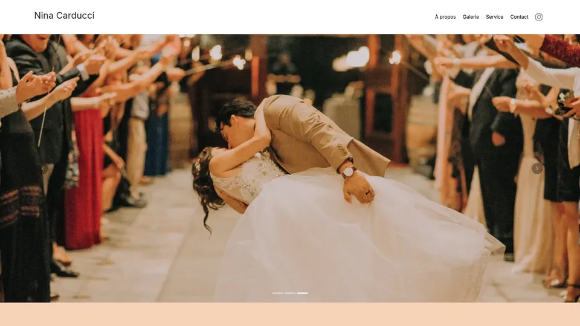
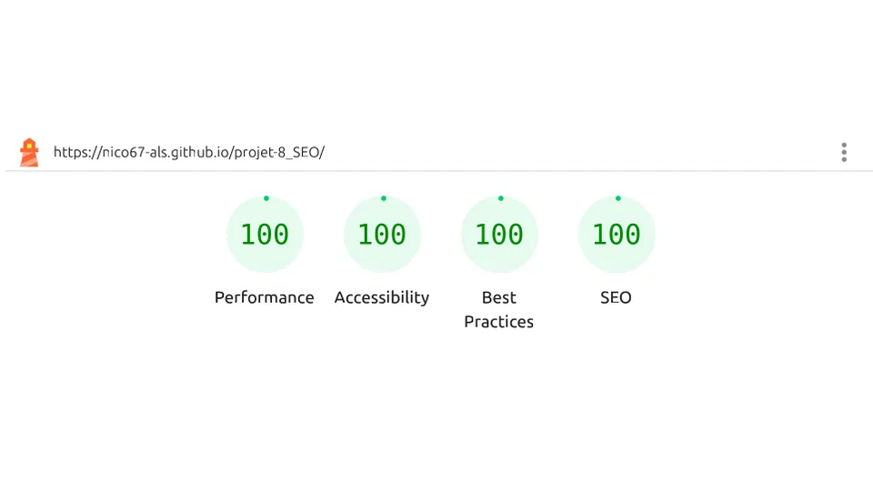

# Nina Carducci : optimisation SEO, performance et accessibilité

Projet 8 du parcours Développeur web d'OpenClassrooms : audit et optimisation du site d'une
photographe, sans toucher à son design.

**Site en ligne :** https://nico67-als.github.io/projet-8_SEO/

## Résultats

| Mesure Lighthouse          | Avant  | Après |
| -------------------------- | ------ | ----- |
| Performance                | 74     | 100   |
| Accessibilité              | 68     | 100   |
| SEO                        | 73     | 100   |
| Affichage de l'image (LCP) | 16,2 s | 0,7 s |

Les quatre catégories Lighthouse atteignent 100/100 sur le site en ligne. WAVE ne relève aucune
erreur, et le test des résultats enrichis de Google valide deux éléments : commerce local et
organisation.

## Contexte

Nina Carducci, photographe à Bordeaux, avait un site lent et mal référencé, avec une image
principale qui mettait 16,2 s à s'afficher. La mission : l'optimiser sans toucher au design.

## Objectifs

- Dépasser 90/100 sur Lighthouse en performance, SEO et accessibilité.
- Améliorer la visibilité locale de la photographe.

## Ce que j'ai fait

- Mené l'audit (Lighthouse, WAVE), puis priorisé les corrections par impact.
- Converti les images en WebP, redimensionnées et chargées en différé.
- Rendu le HTML sémantique et corrigé les libellés de formulaire.
- Ajouté les données structurées Schema.org pour le référencement local, et les balises
  Open Graph.
- Corrigé un contraste de 2,12:1 en le passant à 9,87:1.

## Stack

HTML5, CSS3, Bootstrap, jQuery, Schema.org, Open Graph.
Outils : Lighthouse, WAVE, test des résultats enrichis de Google. Hébergement : GitHub Pages.

## Pistes d'amélioration

- Supprimer le CSS et le JavaScript de Bootstrap inutilisés.
- Remplacer le plugin jQuery de la galerie.
- Créer une image de partage au format 1200×630.

## Lancer en local

Site statique : ouvrir `index.html` dans un navigateur, ou servir le dossier avec l'extension
Live Server de VS Code.

---

Projet présenté dans mon portfolio : https://nicolas-grasser.vercel.app
